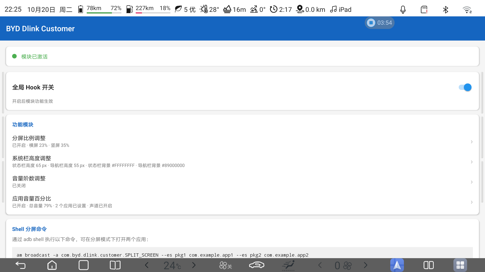
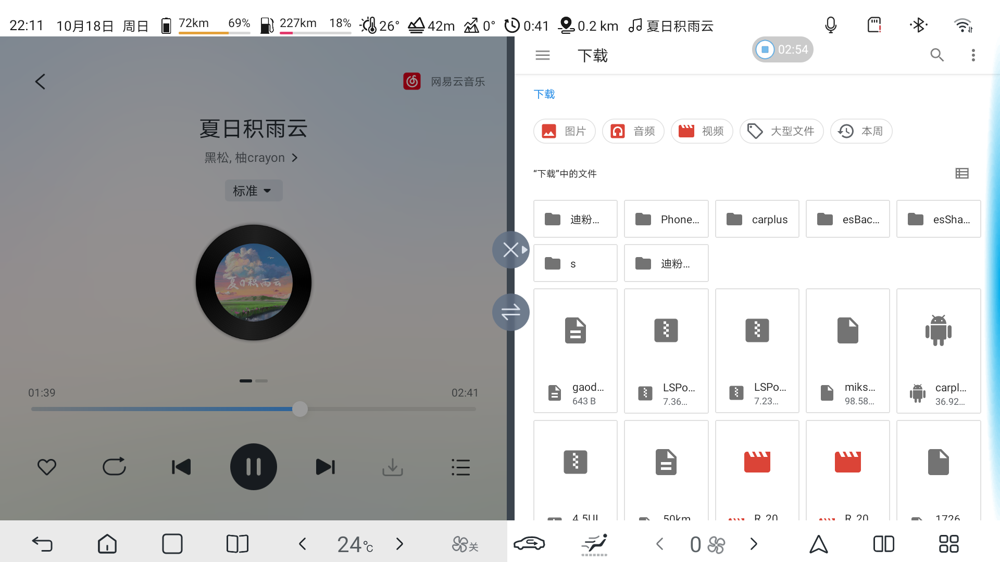
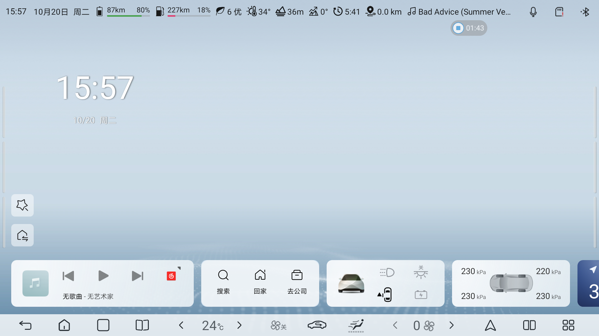

# BYD Dlink Customer

[English Version](#english-version) | [中文版本](#中文版本)

---

<a id="english-version"></a>
# BYD Dlink Customer - English Version

An Xposed module for BYD automotive Dlink infotainment system, providing extensive customization options for split-screen, system bars, and audio control.

## Features

### ️ Split-Screen Control
- **Custom Ratio**: Adjust split-screen ratio from 10% to 90%
- **Snap Points**: Smart snapping at 27%, 50%, and 73%
- **Blacklist Bypass**: Disable app split-screen restrictions
- **Landscape/Portrait**: Independent ratio settings for both orientations

### 🎨 System Bar Customization
- **Height Adjustment**: Customize status bar and navigation bar height
- **Background Color**: Set custom colors with alpha transparency support
- **Immersive Mode**: Choose between fixed color or auto-adaptive color
- **Auto Color Adaptation**: Automatically sample screen edge colors (Dynamic Color Adaptation)

### 🔊 Audio Control
- **Per-App Volume**: Individual volume percentage for each app
- **Master Volume**: Global volume multiplier (effective = master% × app%)
- **Channel Routing**: Redirect app audio to different output channels
- **Volume Steps**: Adjust step count for each audio stream

### 🎯 Icon Color Adaptation
- **Smart Contrast**: Navigation bar icons automatically adjust contrast against background
- **Subtree PULL**: Generic color adaptation for all nav bar items

## Screenshots

### Settings Interface


### Split-Screen Feature


### Main Interface


## Requirements

- **Device**: BYD car head unit with Dlink system
- **Android**: 10+ (SDK 29+)
- **Framework**: LSPosed / Xposed
- **Root**: Magisk installed

## Installation

### From GitHub Releases
1. Download the latest APK from [Releases](https://github.com/Ctrl-Ling/BYD-Dlink-Customer/releases)
2. Install the APK
3. Open LSPosed Manager
4. Enable the module and select target apps:
   - `com.android.systemui`
   - `android` (system framework)
   - `system` (system_server)
5. Restart SystemUI or reboot device

### Build from Source
```bash
git clone https://github.com/Ctrl-Ling/BYD-Dlink-Customer.git
cd BYD-Dlink-Customer
./gradlew assembleDebug
```

## Configuration

All settings are stored as system properties (`persist.byd.dlink.*`) for cross-process access:

- **SystemUI** (uid 10066): Bar customization, icon colors
- **system_server** (uid 1000): Framework hooks, volume control
- **Hooked Apps**: Per-app volume and channel settings

## Development

### Build Requirements
- JDK 17 (DevEco Studio JBR or compatible)
- Android SDK 34
- Gradle 8.8

### Project Structure
```
app/src/main/java/com/byd/dlink/customer/
├── hook/           # Xposed hooks
│   ├── SplitScreenHook.java
│   ├── SystemBarHeightHook.java
│   ├── SystemBarBackgroundHook.java
│   ├── BarIconColourHook.java
│   ├── AppGainHook.java
│   ├── AppChannelHook.java
│   └── VolumeStepHook.java
├── ui/             # UI components
│   ├── ColorPickerDialog.java
│   └── GradientBar.java
└── utils/          # Utilities
    ├── PrefsManager.java
    ├── BydChannels.java
    └── VolumeStreams.java
```

## GitHub Actions

Automated build and release workflow:
- **Build**: On push/PR to master
- **Release**: On tag push (v*)
- **Signing**: Automatic keystore signing for releases

## License

This project is for educational and personal use only.

## Disclaimer

This module modifies system behavior. Use at your own risk. The author is not responsible for any damage to your device.

---

<a id="中文版本"></a>
# BYD Dlink Customer - 中文版本

一款针对比亚迪 Dlink 车机系统的 Xposed 模块，提供分屏、系统栏和音频控制的深度自定义功能。

## 功能特性

### 🖥️ 分屏控制
- **自定义比例**: 10% 到 90% 的分屏比例调整
- **智能吸附**: 27%、50%、73% 三个吸附点
- **黑名单绕过**: 禁用应用分屏限制
- **横竖屏独立**: 横屏和竖屏可设置不同比例

### 🎨 系统栏自定义
- **高度调整**: 自定义状态栏和导航栏高度
- **背景颜色**: 支持透明度的自定义颜色
- **沉浸模式**: 固定颜色或自动适应颜色
- **自动变色**: 自动采集屏幕边缘颜色（动态颜色自适应）

### 🔊 音频控制
- **单应用音量**: 每个应用独立的音量百分比
- **总音量控制**: 全局音量倍数（实际输出 = 总音量% × 应用%）
- **声道切换**: 将应用音频重定向到不同输出声道
- **音量阶数**: 调整每个音频流的步进数量

### 🎯 图标颜色适配
- **智能对比**: 导航栏图标根据背景自动调整对比度
- **子树遍历**: 通用的导航栏所有项目颜色适配

## 软件截图

### 设置界面


### 分屏功能


### 主界面效果


## 系统要求

- **设备**: 比亚迪 Dlink 车机系统
- **Android**: 10+ (SDK 29+)
- **框架**: LSPosed / Xposed
- **Root**: 已安装 Magisk

## 安装方法

### 从 GitHub Releases 安装
1. 从 [Releases](https://github.com/Ctrl-Ling/BYD-Dlink-Customer/releases) 下载最新 APK
2. 安装 APK
3. 打开 LSPosed 管理器
4. 启用模块并选择目标应用：
   - `com.android.systemui`
   - `android`（系统框架）
   - `system`（system_server）
5. 重启 SystemUI 或重启设备

### 从源码编译
```bash
git clone https://github.com/Ctrl-Ling/BYD-Dlink-Customer.git
cd BYD-Dlink-Customer
./gradlew assembleDebug
```

## 配置存储

所有设置以系统属性（`persist.byd.dlink.*`）形式存储，支持跨进程访问：

- **SystemUI** (uid 10066): 栏自定义、图标颜色
- **system_server** (uid 1000): 框架钩子、音量控制
- **Hook 应用**: 单应用音量和声道设置

## 开发信息

### 编译环境
- JDK 17（DevEco Studio JBR 或兼容版本）
- Android SDK 34
- Gradle 8.8

### 项目结构
```
app/src/main/java/com/byd/dlink/customer/
├── hook/           # Xposed 钩子
│   ├── SplitScreenHook.java      # 分屏控制
│   ├── SystemBarHeightHook.java  # 栏高度
│   ├── SystemBarBackgroundHook.java  # 栏背景
│   ├── BarIconColourHook.java    # 图标颜色
│   ├── AppGainHook.java          # 应用音量
│   ├── AppChannelHook.java       # 声道切换
│   ── VolumeStepHook.java       # 音量阶数
├── ui/             # UI 组件
│   ├── ColorPickerDialog.java    # 颜色选择器
│   └── GradientBar.java          # 渐变条
└── utils/          # 工具类
    ├── PrefsManager.java         # 配置管理
    ├── BydChannels.java          # 声道映射
    └── VolumeStreams.java        # 音频流
```

## GitHub Actions

自动化构建和发布流程：
- **构建**: 推送到 master 或 PR 时触发
- **发布**: 推送版本标签（v*）时触发
- **签名**: 自动使用 keystore 签名发布版本

## 许可证

本项目仅供教育和个人使用。

## 免责声明

本模块会修改系统行为，使用风险自负。作者不对设备损坏承担任何责任。
