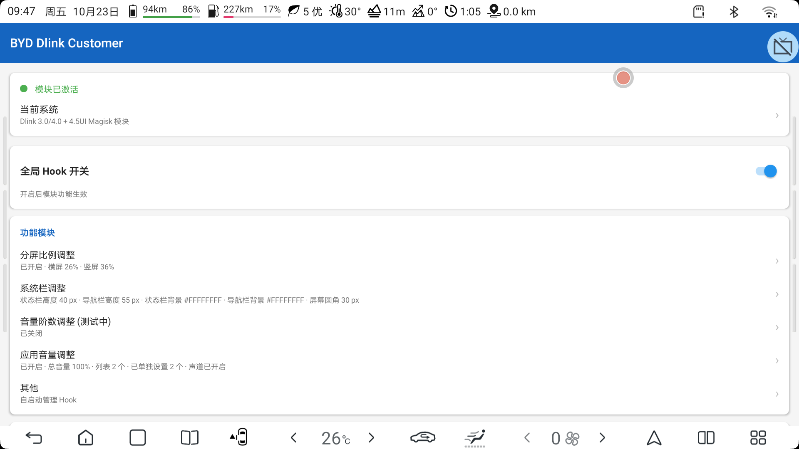
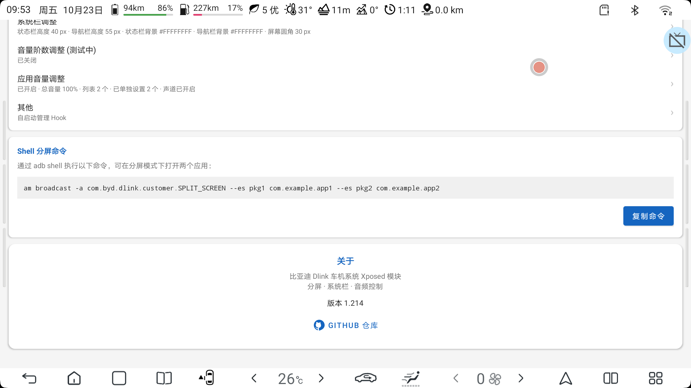
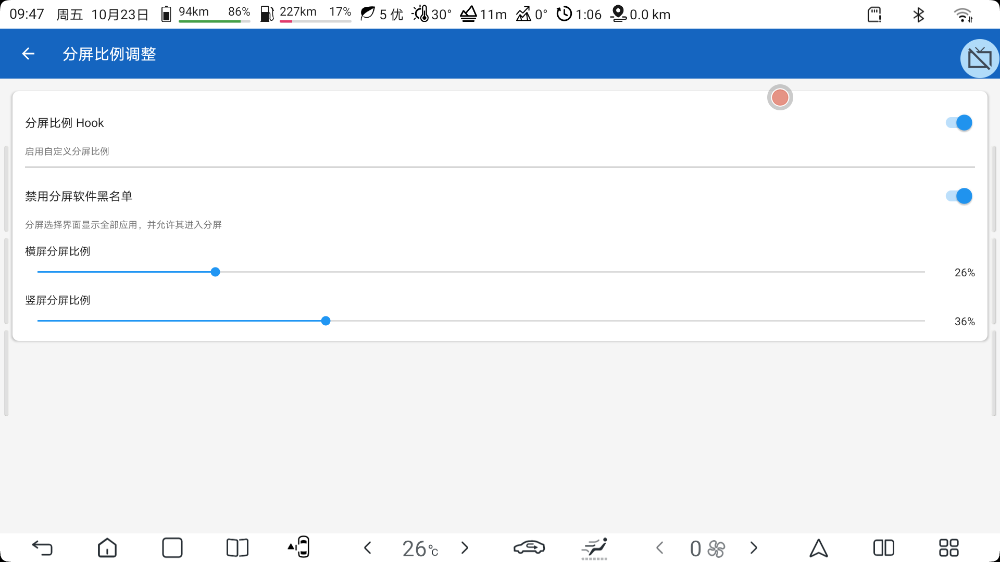
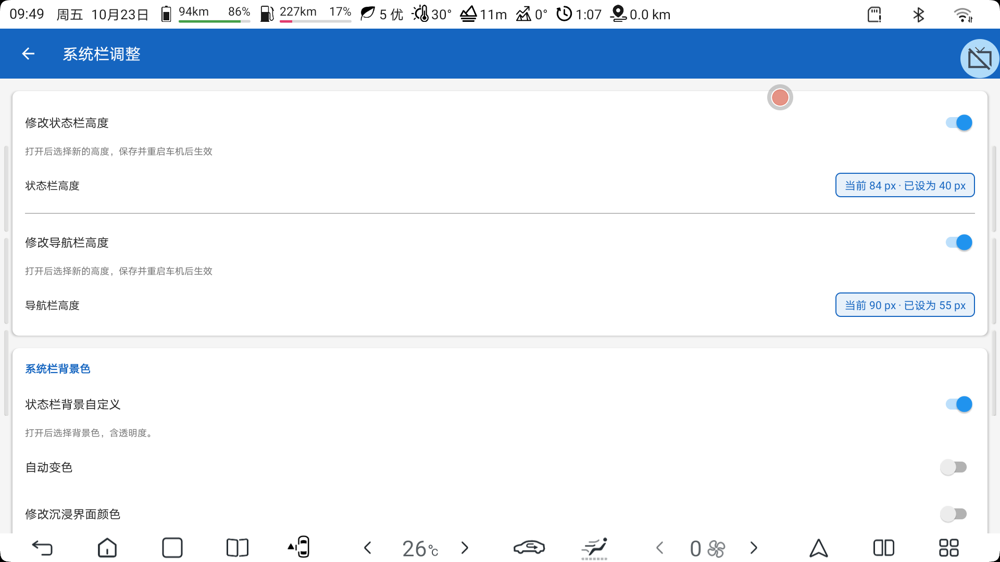
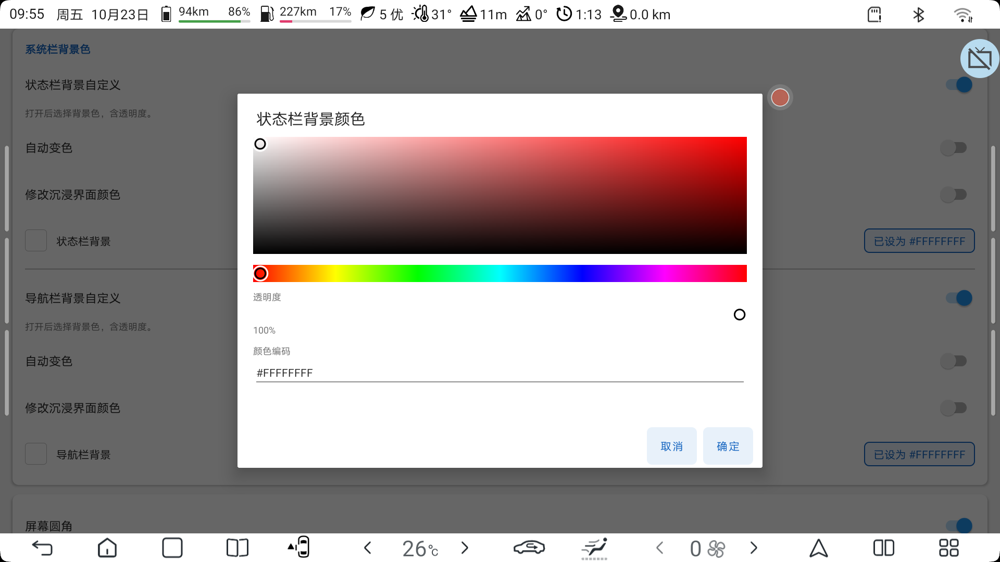
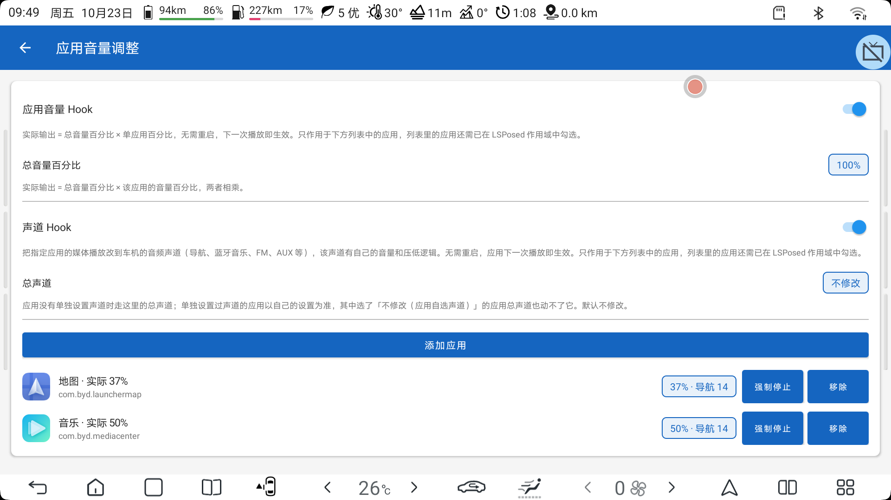
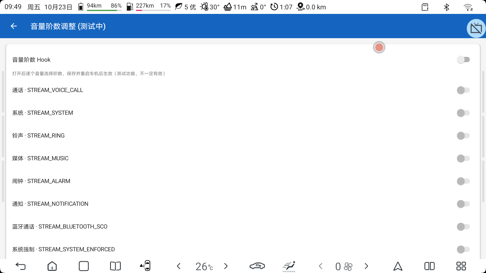
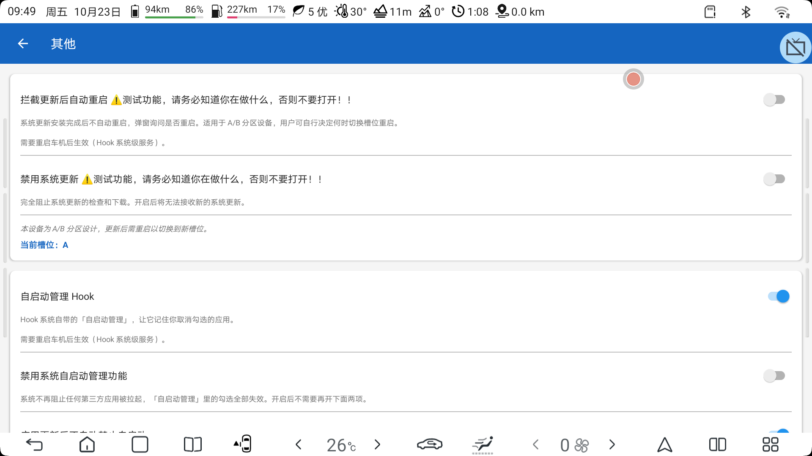

# BYD Dlink Customer

[English Version](#english-version) | [中文版本](#中文版本)

---

<a id="english-version"></a>
# BYD Dlink Customer - English Version

An Xposed module for BYD automotive Dlink infotainment system, providing extensive customization options for split-screen, system bars, audio, and head-unit behaviour (autostart and system updates).

## Features

### ️ Split-Screen Control
- **Custom Ratio**: 10% – 90%, set separately for landscape and portrait
- **Snap Points**: the divider settles on the configured ratio, the screen middle, or the mirrored ratio (26% setting → the narrow half can sit on either side)
- **Ratio Honoured By A Launched Split**: a pair composed by command lands on the configured ratio too, not on 50%
- **Blacklist Bypass**: the split picker lists every installed app and lets it enter split-screen
- **Shell Command**: `am broadcast` opens two apps side by side; the exact command is printed on the home page for copying
- **Drag Kept Cheap**: the per-frame work this module does while you drag the divider is cached, so dragging stays smooth

### 🎨 System Bar Customization
- **Height Adjustment**: status bar and navigation bar, up to 20% of the screen height (laid out at boot, so a head-unit reboot is required)
- **Background Color**: any color with alpha, picked on a palette or typed as `#AARRGGBB` / `#RRGGBB`
- **Immersive Color**: color the strip an app draws behind the bar, separately from the bar's own color
- **Auto Color Adaptation**: sample the screen edge immediately beside the bar and follow it, per bar (Dynamic Color Adaptation)
- **Icon Color Adaptation**: navigation bar icons are re-tinted against whatever the bar actually looks like, by bitmap coverage rather than by guessing per app
- **Screen Corners**: black corners drawn inside the bars to imitate a rounded panel; radius is capped by whichever bar is shorter

### 🔊 Audio Control
- **Per-App Volume**: effective output = master % × app %, no restart, applies on the app's next playback
- **Channel Routing**: redirect an app's playback to one of the head unit's audio channels (navigation, Bluetooth music, FM, AUX, …), which each have their own volume and ducking; a master channel covers apps with no setting of their own
- **Volume Steps**: change the step count of each audio stream *(experimental, may not take effect)*

### ⚙️ System Behaviour
- **Autostart Management**: make the stock autostart screen remember the apps you un-tick, stop it re-forbidding apps after an update or a fresh install, or switch the whole mechanism off
- **OTA Control**: block the update check and download entirely, or intercept the reboot an update schedules and ask you first *(experimental)*
- **Current System**: three sets of hook points — Dlink 3.0/4.0, Dlink 3.0/4.0 + the 4.5 UI Magisk module, Dlink 5.0+ — picked inside the app and applied by restarting SystemUI
- **Global Switch**: one switch turns every hook off

## Screenshots

### Home


### Shell Split Command & About


### Split-Screen Settings


### System Bar Settings


### Color Picker


### Per-App Volume & Channel


### Volume Steps


### OTA & Autostart


### Split In Action (this module + Via, 26% / 74%)


### Desktop With Customized Bars


## Requirements

- **Test Device**: BYD 2021 Song Plus DM-i 13.5 controller
- **Test System**: Dlink 4.0 UI + Dlink 4.5 UI Magisk module (backports Dlink 5.0 UI to Dlink 4.0 — [intro](https://mp.weixin.qq.com/s/UJ9pEdRMv9ABVD8v1OHsPQ) | [download](https://www.kdocs.cn/l/cvlTNElqC0U3))
- **Android**: 10 (SDK 29+, compiled against SDK 34)
- **Framework**: LSPosed / Xposed
- **Root**: Magisk installed
- Set **Current System** in the app to match your head unit before judging any feature as broken — the hook points differ per system.

## Installation

### From GitHub Releases
1. Download the latest APK from [Releases](https://github.com/Ctrl-Ling/BYD-Dlink-Customer/releases)
2. Install the APK
3. Open LSPosed Manager
4. Enable the module and select the scope:
   - `com.android.systemui` — split screen, system bars, bar colors, icons, screen corners
   - `android` (System Framework, i.e. system_server) — bar height at boot, volume steps, autostart, OTA reboot intercept
   - `com.byd.otaupdate` and `com.byd.updated` — disabling system updates
   - every app you want per-app volume or channel routing on
   - `com.byd.dlink.customer` itself — activation detection
5. Restart SystemUI, or reboot the head unit (framework hooks need a full reboot)

### Build from Source
```bash
git clone https://github.com/Ctrl-Ling/BYD-Dlink-Customer.git
cd BYD-Dlink-Customer
./gradlew assembleDebug
```

## Configuration

The settings page writes its own private `config.properties`, then — through root — copies it to
`/data/local/tmp/byd_dlink_config.properties` (mode 666, so other processes can read it) and mirrors
every property-mapped key into a system property (`persist.byd.dlink.*`). The hooks read the
properties, because SELinux lets every domain read them and they cost microseconds with no Binder.

- **SystemUI**: split ratio and snapping, bar colors, icon contrast, screen corners
- **system_server** (`android`): bar heights published at boot, volume steps, autostart, OTA reboot intercept
- **Hooked apps**: per-app volume percentage and output channel

## Development

### Build Requirements
- JDK 17 (DevEco Studio JBR or compatible)
- Android SDK 34
- Gradle 8.8

### Project Structure
```
app/src/main/java/com/byd/dlink/customer/
├── SettingsActivity.java        # the whole settings UI (pages built in code)
├── hook/                        # Xposed hooks
│   ├── MainHook.java            # entry point, routes by process
│   ├── SplitScreenHook.java     # ratio, snapping, divider drag
│   ├── AppBlacklistHook.java    # split-screen blacklist bypass
│   ├── CommandReceiver.java     # SPLIT_SCREEN broadcast
│   ├── SystemBarHeightHook.java # status / navigation bar height
│   ├── SystemBarBackgroundHook.java
│   ├── BarIconColourHook.java   # nav bar icon contrast
│   ├── BarContentCentreHook.java
│   ├── ScreenCornerHook.java    # rounded-corner masks
│   ├── ScreenEdgeSampler.java   # auto color adaptation sampling
│   ├── AppGainHook.java         # per-app volume
│   ├── AppChannelHook.java      # per-app output channel
│   ├── NaviVolumeChannel.java   # navigation volume channel
│   ├── VolumeStepHook.java      # volume steps (experimental)
│   ├── VolumePanelHook.java
│   ├── AppStartHook.java        # autostart management
│   ├── OtaRebootHook.java       # OTA reboot intercept / update block
│   └── ViewTreeDump.java        # on-device view diagnostics
├── ui/                          # UI components
│   ├── ColorPickerDialog.java
│   ├── GradientBar.java
│   └── SatValPanel.java
└── utils/                       # Utilities
    ├── PrefsManager.java        # config <-> persist.byd.dlink.* properties
    ├── SystemBarDimens.java
    ├── BydChannels.java         # head-unit audio channel table
    └── VolumeStreams.java       # audio stream table
```

## GitHub Actions

Automated build and release workflow:
- **Build**: On push/PR to `master` / `main`
- **Release**: On tag push (v*)
- **Signing**: Automatic keystore signing for releases

## License

This project is for educational and personal use only.

## ⚠️ Disclaimer & Risk Warning

This module has only been tested on specific devices and environments (BYD 2021 Song Plus DM-i 13.5 controller with Dlink 4.0 + 4.5 UI Magisk module). **Using it on other devices or system versions may brick your device.**

**Before installing, make sure you understand what you are doing.** It is strongly recommended to install the automatic brick rescue Magisk module first:

> [神仙自动救砖 - 支持 OTA 稳定（重启前可刷救砖模块）](magisk_module/Automatic_brick_rescue_Magisk模块-神仙自动救砖-支持OTA稳定（重启前可刷救砖模块）.zip)

This module modifies system behavior. Use at your own risk. The author is not responsible for any damage to your device.

---

<a id="中文版本"></a>
# 迪客（BYD Dlink Customer）- 中文版本

「迪客」是一款针对比亚迪 Dlink 车机系统的 Xposed 模块，提供分屏、系统栏、音频，以及车机行为（自启动、系统更新）的深度自定义功能。

## 功能特性

### 🖥️ 分屏控制
- **自定义比例**: 10% ~ 90%，横屏、竖屏分别设置
- **智能吸附**: 分屏条停在配置比例、屏幕正中、或比例的镜像位（设 26% 时窄的一侧可以落在任意一边）
- **命令拉起的分屏也按比例**: 用广播组合出来的一对应用同样落到配置比例，不再停在 50%
- **黑名单绕过**: 分屏选择界面列出全部应用，并允许它们进入分屏
- **Shell 分屏命令**: 主页直接给出可复制的 `am broadcast` 命令，一条命令并排打开两个应用
- **拖动不额外卡顿**: 拖动分屏条时每帧本模块要做的事都已缓存，不给手势添开销

### 🎨 系统栏自定义
- **高度调整**: 状态栏、导航栏各自可调（不超过屏幕高度 20%），开机排版，需重启车机生效
- **背景颜色**: 任意颜色含透明度，调色盘选取或直接输入 `#AARRGGBB` / `#RRGGBB`
- **修改沉浸界面颜色**: 单独给应用画到栏后面的那一条上色，与栏本身颜色互不影响
- **自动变色**: 取紧贴本栏的屏幕边缘颜色，两条栏各开各的（动态颜色自适应）
- **图标颜色适配**: 导航栏图标按栏子树的实际观感重新着色，依据是位图覆盖率而不是逐个应用猜类名
- **屏幕圆角**: 在栏内画出黑角模拟圆角屏，半径上限 = 两条栏中较矮的一条

### 🔊 音频控制
- **单应用音量**: 实际输出 = 总音量% × 该应用%，无需重启，应用下一次播放即生效
- **应用输出声道**: 把指定应用的播放改到车机的某个音频声道（导航、蓝牙音乐、FM、AUX 等，各有自己的音量与压低逻辑），另设「总声道」兜底未单独设置的应用
- **音量阶数**: 逐个音量流调整步进数量 *（测试功能，不一定有效）*

### ⚙️ 系统行为
- **自启动管理**: 让系统自带的「自启动管理」记住你取消勾选的应用；可选应用更新后、新安装后不再自动禁止自启动，或整体关掉这套限制
- **OTA 更新控制**: 完全禁用系统更新的检查与下载，或拦截更新完成后自动发起的重启、改为弹窗询问 *（测试功能）*
- **当前系统**: 三套 hook 点位（Dlink 3.0/4.0、Dlink 3.0/4.0 + 4.5UI Magisk 模块、Dlink 5.0 及以上），在 App 里选择，重启系统界面即生效
- **全局 Hook 开关**: 一个开关关掉本模块全部功能

## 软件截图

### 主页


### Shell 分屏命令与关于


### 分屏比例调整


### 系统栏调整


### 颜色选择器


### 应用音量与声道


### 音量阶数调整


### 其他（OTA 与自启动）


### 分屏效果（本模块 + Via 浏览器，26% / 74%）


### 定制后的桌面


## 系统要求

- **测试设备**: 比亚迪 2021 宋 Plus DM-i 13.5 控制器
- **测试系统**: Dlink 4.0 UI + Dlink 4.5 UI Magisk 模块（为 Dlink 4.0 系统移植 Dlink 5.0 界面 — [介绍](https://mp.weixin.qq.com/s/UJ9pEdRMv9ABVD8v1OHsPQ) | [下载](https://www.kdocs.cn/l/cvlTNElqC0U3)）
- **Android**: 10（SDK 29+，编译目标 SDK 34）
- **框架**: LSPosed / Xposed
- **Root**: 已安装 Magisk
- 判断某个功能是否失效之前，请先在 App 里把「当前系统」选成你车机的实际系统——不同系统的 hook 点位不同。

## 安装方法

### 从 GitHub Releases 安装
1. 从 [Releases](https://github.com/Ctrl-Ling/BYD-Dlink-Customer/releases) 下载最新 APK
2. 安装 APK（中文环境下模块名显示为「迪客」，英文环境仍为 BYD Dlink Customer）
3. 打开 LSPosed 管理器
4. 启用模块并勾选作用域：
   - `com.android.systemui` —— 分屏、系统栏、栏背景色、图标颜色、屏幕圆角
   - `android`（系统框架，即 system_server）—— 开机发布的栏高、音量阶数、自启动、OTA 重启拦截
   - `com.byd.otaupdate`、`com.byd.updated` —— 禁用系统更新
   - 需要单应用音量/声道的每一个应用
   - `com.byd.dlink.customer` 自身 —— 用于检测模块是否已激活
5. 重启系统界面（SystemUI）；框架侧的 hook 需要重启车机

### 从源码编译
```bash
git clone https://github.com/Ctrl-Ling/BYD-Dlink-Customer.git
cd BYD-Dlink-Customer
./gradlew assembleDebug
```

## 配置存储

设置页写自己私有的 `config.properties`，保存时经 root 复制一份到 `/data/local/tmp/byd_dlink_config.properties`（666，其他进程可读），并把有属性映射的键同步成系统属性（`persist.byd.dlink.*`）。钩子实时读的是属性——SELinux 允许所有域读属性，微秒级、不走 Binder。

## 开发信息

### 编译环境
- JDK 17（DevEco Studio JBR 或兼容版本）
- Android SDK 34
- Gradle 8.8

### 项目结构
```
app/src/main/java/com/byd/dlink/customer/
├── SettingsActivity.java        # 整套设置界面（页面由代码构建）
├── hook/                        # Xposed 钩子
│   ├── MainHook.java            # 入口，按进程分发
│   ├── SplitScreenHook.java     # 分屏比例、吸附、分屏条拖动
│   ├── AppBlacklistHook.java    # 分屏黑名单绕过
│   ├── CommandReceiver.java     # SPLIT_SCREEN 广播
│   ├── SystemBarHeightHook.java # 状态栏 / 导航栏高度
│   ├── SystemBarBackgroundHook.java
│   ├── BarIconColourHook.java   # 导航栏图标对比色
│   ├── BarContentCentreHook.java
│   ├── ScreenCornerHook.java    # 屏幕圆角遮罩
│   ├── ScreenEdgeSampler.java   # 自动变色取色
│   ├── AppGainHook.java         # 单应用音量
│   ├── AppChannelHook.java      # 单应用输出声道
│   ├── NaviVolumeChannel.java   # 导航音量声道
│   ├── VolumeStepHook.java      # 音量阶数（测试中）
│   ├── VolumePanelHook.java
│   ├── AppStartHook.java        # 自启动管理
│   ├── OtaRebootHook.java       # OTA 重启拦截 / 禁用更新
│   └── ViewTreeDump.java        # 车机上的视图树诊断
├── ui/                          # UI 组件
│   ├── ColorPickerDialog.java   # 颜色选择器
│   ├── GradientBar.java         # 色相 / 透明度条
│   └── SatValPanel.java         # 调色盘面板
└── utils/                       # 工具类
    ├── PrefsManager.java        # 配置 <-> persist.byd.dlink.* 属性
    ├── SystemBarDimens.java
    ├── BydChannels.java         # 车机声道映射表
    └── VolumeStreams.java       # 音频流表
```

## GitHub Actions

自动化构建和发布流程：
- **构建**: 推送到 `master` / `main` 或提交 PR 时触发
- **发布**: 推送版本标签（v*）时触发
- **签名**: 自动使用 keystore 签名发布版本

## 许可证

本项目仅供教育和个人使用。

## ⚠️ 免责声明与风险警告

本模块仅在特定设备和环境下测试通过（比亚迪 2021 宋 Plus DM-i 13.5 控制器 + Dlink 4.0 + 4.5 UI Magisk 模块）。**在其他设备或系统版本上使用可能导致砖机。**

**安装前请确保你知道自己在做什么。** 强烈建议先安装自动救砖 Magisk 模块：

> [神仙自动救砖 - 支持 OTA 稳定（重启前可刷救砖模块）](magisk_module/Automatic_brick_rescue_Magisk模块-神仙自动救砖-支持OTA稳定（重启前可刷救砖模块）.zip)

本模块会修改系统行为，使用风险自负。作者不对设备损坏承担任何责任。
